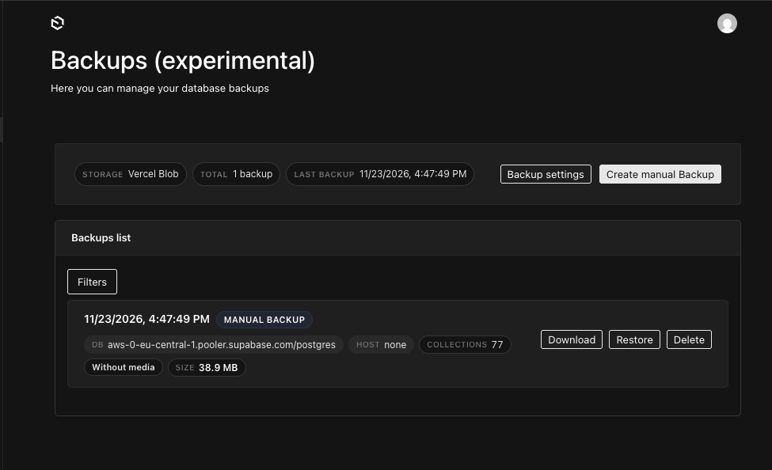
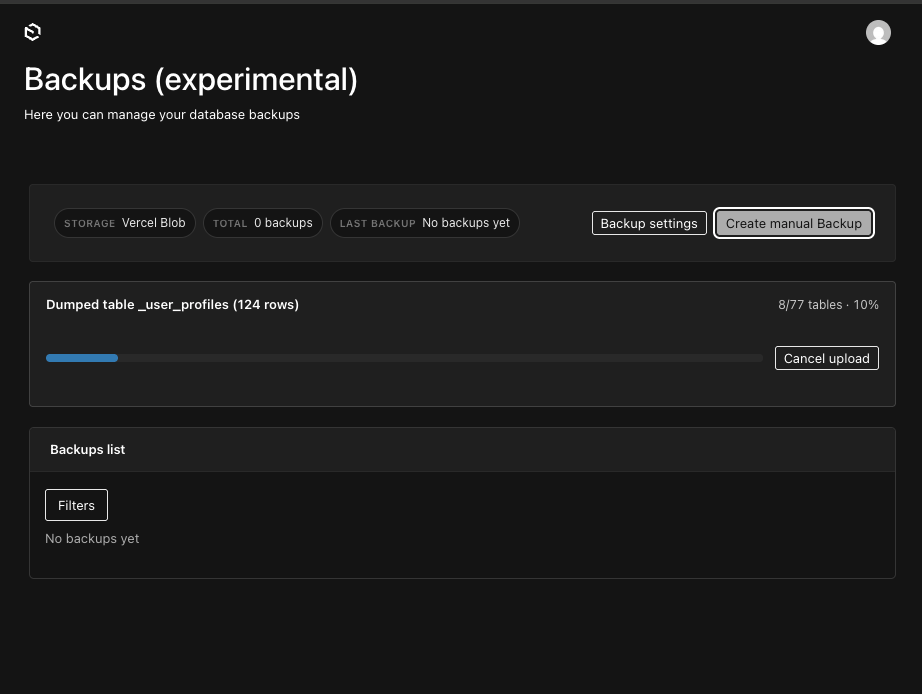

# payload-plugin-backup-postgres

Backup and restore for **Payload CMS 3 on PostgreSQL**: scheduled (cron) and
on-demand backups to **Vercel Blob** or **S3-compatible storage** (AWS S3,
Cloudflare R2, MinIO), an admin dashboard with per-collection preview, selective
restore, and optional media bundling.

This is a Postgres port of
[`@trieb.work/payload-plugin-backup-mongodb`](https://github.com/trieb-work/payload-plugin-backup-mongodb)
(MIT). The admin UI, endpoints, storage layer and task/progress model are kept;
the database engine was rewritten for Payload's Drizzle/Postgres adapter.

## How it differs from the MongoDB plugin

|                      | MongoDB plugin                  | This plugin                                                                                                                                                        |
| -------------------- | ------------------------------- | ------------------------------------------------------------------------------------------------------------------------------------------------------------------ |
| Adapter              | `@payloadcms/db-mongodb`        | `@payloadcms/db-postgres`, `@payloadcms/db-vercel-postgres`                                                                                                        |
| Unit of backup       | Mongo collection                | Postgres table, grouped per Payload collection/global in the UI (`posts`, `posts_locales`, `posts_rels`, `_posts_v`, … toggle together)                            |
| Snapshot             | collection by collection        | **one `REPEATABLE READ READ ONLY` transaction** – all tables from the same instant                                                                                 |
| Serialization        | EJSON                           | rows serialized by Postgres (`json_agg`) and restored with `json_populate_recordset`; `numeric`, `bigint`, `jsonb`, arrays, `bytea`, timestamps round-trip exactly |
| Restore              | per collection, best effort     | **atomic by default** (single transaction, rolled back if any table fails); FK-aware ordering, cycles and self references handled, sequences reset                 |
| Merge restore        | upsert by `_id` / unique fields | per **document**: rows of documents in the backup replace the live ones (incl. their locales, arrays, blocks, rels); other documents are kept                      |
| Progress-row cleanup | TTL index                       | pruned on start-up and on each new task (> 30 min)                                                                                                                 |
| Settings field       | `skipMongoCollections`          | `skipTables`                                                                                                                                                       |
| Routes               | `/api/backup-mongodb/...`       | `/api/backup-postgres/...`                                                                                                                                         |

Backups are **not** interchangeable between the two plugins.

## Screenshots

### Backup dashboard



### Task progress



## Requirements

- Payload `^3`, Next.js 15/16, React 19, Node `>=20.9`
- `@payloadcms/db-postgres` or `@payloadcms/db-vercel-postgres` (the plugin uses
  the adapter's `pool` and `schemaName`)
- A backup target: Vercel Blob (`BLOB_READ_WRITE_TOKEN`) or S3
  (`BACKUP_STORAGE=s3`)

### Environment variables

| Variable                                         | Purpose                                                                        |
| ------------------------------------------------ | ------------------------------------------------------------------------------ |
| `BLOB_READ_WRITE_TOKEN`                          | Vercel Blob token (backup target and/or media source)                          |
| `CRON_SECRET`                                    | Bearer secret for `/api/backup-postgres/cron/*`                                |
| `BACKUPS_TO_KEEP`                                | Cron retention (default 10)                                                    |
| `BACKUP_STORAGE`, `BACKUP_S3_*`                  | S3 target, see below                                                           |
| `PAYLOAD_BACKUP_ALLOWED_ROLES`                   | Comma-separated roles (or `*`) that see the dashboard                          |
| `DATABASE_URI` / `DATABASE_URL` / `POSTGRES_URL` | Only used to label backups with `host/dbname` (credentials are never included) |

## Installation

```bash
pnpm add payload-plugin-backup-postgres
```

```ts
// payload.config.ts
import { postgresAdapter } from '@payloadcms/db-postgres'
import { backupPostgresPlugin } from 'payload-plugin-backup-postgres'

export default buildConfig({
  db: postgresAdapter({ pool: { connectionString: process.env.DATABASE_URI } }),
  plugins: [
    backupPostgresPlugin({
      // backupsToKeep: 14,
      // access: (user) => user?.role === 'admin',
    }),
  ],
})
```

Then:

1. **Create a migration** if you run with migrations (`push: false`, i.e.
   production): the plugin adds the `backup-tasks` and `backup-settings`
   collections (`backup_tasks`, `backup_settings`,
   `backup_settings_skip_tables`).
   `pnpm payload migrate:create add-backup-plugin && pnpm payload migrate`
2. Regenerate the import map: `pnpm payload generate:importmap`
3. Optional cron (Vercel):

```json
{
  "crons": [
    { "path": "/api/backup-postgres/cron/run", "schedule": "0 3 * * *" }
  ]
}
```

## Restore semantics (Postgres)

- **Replace (default):** for each restored table, rows not present in the backup
  are deleted (children first), then backup rows are upserted (parents first).
- **Merge:** documents present in the backup are reset to their backed-up state
  (their child rows in `<table>_locales`, `_rels`, arrays and blocks are
  replaced); documents created after the backup are kept. Live rows that collide
  with a backup row on a unique key under a different id (e.g. a user re-created
  with the same email) are evicted.
- **Ordering:** tables are ordered from the live foreign-key graph. Self
  references (nested categories/folders) and cycles (e.g.
  `users.avatar → media`, `media.owner → users`) are written as `NULL` first and
  linked in a second pass.
- **Schema drift:** only columns present in both the backup and the current
  table are written; new columns get their defaults. Tables that no longer exist
  are reported as warnings without aborting. Run your migrations before
  restoring an older backup.
- **Sequences** owned by restored tables are set to `max(id)`.
- **Atomic:** any SQL failure rolls the whole database restore back (reported
  per table). Programmatic callers can pass `{ atomic: false }` to keep the
  tables that succeeded.
- `backup-tasks` rows are never replaced while a tracked restore is running.

Archive format: `.json` (no media) or `.tar.gz` (`database.json` +
`media/<pathname>`), where `database.json` is
`{ format: "payload-plugin-backup-postgres", version: 1, schema, serverVersion, createdAt, tables: { [name]: { rowCount, rows } } }`
and `rows` is the JSON text produced by Postgres.

Media bundling reads `filename`, `sizes_*_filename` (and `prefix`, if present)
from every upload-enabled collection, fetched from the Vercel Blob upload store.

## Choosing a backup target (Vercel Blob or S3)

Backups can be stored in **Vercel Blob** (default) or **AWS S3**. The S3 target
also works with any S3-compatible store — **Cloudflare R2**, **MinIO**, etc. —
because they share the same API; only the configuration differs, never the
plugin code.

Select the target with `BACKUP_STORAGE`. When unset it stays `vercel-blob`, so
existing deployments are unaffected.

### Using S3

S3 is enabled when `BACKUP_STORAGE=s3`. Install the AWS SDK (declared as
optional peer dependencies, so Vercel-only installs don't pull it in):

```bash
pnpm add @aws-sdk/client-s3 @aws-sdk/lib-storage @aws-sdk/s3-request-presigner
```

| Variable                      | Required | Purpose                                                                                                               |
| ----------------------------- | -------- | --------------------------------------------------------------------------------------------------------------------- |
| `BACKUP_STORAGE`              | yes      | Set to `s3`.                                                                                                          |
| `BACKUP_S3_BUCKET`            | yes      | Target bucket name.                                                                                                   |
| `BACKUP_S3_REGION`            | optional | Region. Falls back to `AWS_REGION`, then `us-east-1`.                                                                 |
| `BACKUP_S3_ENDPOINT`          | optional | Custom endpoint for S3-compatible stores (R2, MinIO). Omit for AWS S3.                                                |
| `BACKUP_S3_FORCE_PATH_STYLE`  | optional | Path-style addressing. Defaults to `true` when an endpoint is set (needed for MinIO and some R2 setups).              |
| `BACKUP_S3_PREFIX`            | optional | Key namespace prepended to every object (for sharing a bucket). Backups still list/restore by their `backups/…` name. |
| `BACKUP_S3_ACCESS_KEY_ID`     | optional | Access key. Falls back to `AWS_ACCESS_KEY_ID`. Omit to use the AWS default credential chain (IAM roles, etc.).        |
| `BACKUP_S3_SECRET_ACCESS_KEY` | optional | Secret key. Falls back to `AWS_SECRET_ACCESS_KEY`.                                                                    |
| `BACKUP_S3_SESSION_TOKEN`     | optional | Session token for temporary credentials. Falls back to `AWS_SESSION_TOKEN`.                                           |

Credentials are optional: when omitted, the AWS SDK's default provider chain is
used (environment, shared config, or instance/role credentials — recommended on
AWS).

**AWS S3**

```bash
BACKUP_STORAGE=s3
BACKUP_S3_BUCKET=my-payload-backups
BACKUP_S3_REGION=eu-central-1
# Credentials via IAM role (recommended) or:
# BACKUP_S3_ACCESS_KEY_ID=...
# BACKUP_S3_SECRET_ACCESS_KEY=...
```

**Cloudflare R2**

```bash
BACKUP_STORAGE=s3
BACKUP_S3_BUCKET=my-payload-backups
BACKUP_S3_REGION=auto
BACKUP_S3_ENDPOINT=https://<account-id>.r2.cloudflarestorage.com
BACKUP_S3_FORCE_PATH_STYLE=true
BACKUP_S3_ACCESS_KEY_ID=<r2-access-key-id>
BACKUP_S3_SECRET_ACCESS_KEY=<r2-secret-access-key>
```

Backups are stored under the same `backups/…` keys (see
[Blob naming](#blob-naming)), so listing and restore work identically across
targets. Downloads stream through the plugin's authenticated endpoint, so the
bucket does **not** need to be public.

> **Note on media:** the "include media" option bundles files from your Payload
> **Vercel Blob upload store** (`BLOB_READ_WRITE_TOKEN`). The configurable
> target above governs where backup **archives** live only; media is always read
> from and restored to the upload store, even when `BACKUP_STORAGE=s3`.

---

## Admin UI

After the first login as an admin user, the backup dashboard is available at
`/admin/db-backups`. Day-to-day tasks — create, download, restore, delete,
schedule — are managed on this dedicated page.

**Who can see it?** The visibility rules, in precedence order:

1. If the plugin is registered with an `access` function, it wins (see
   [Plugin options](#plugin-options)).
2. Otherwise, if `PAYLOAD_BACKUP_ALLOWED_ROLES` is set, it is used as a
   comma-separated allow-list of role slugs (case-insensitive). Use `*` for "any
   authenticated user". Example:
   `PAYLOAD_BACKUP_ALLOWED_ROLES=admin,superadmin`.
3. Otherwise, the historical default applies: users with a `role` whose slug is
   `admin` see the dashboard; projects that don't use a `roles` field at all get
   the dashboard for any authenticated user.

### Scheduled (cron) vs on-demand (manual) backups

- **Scheduled / cron** backups follow shared settings: retention, media toggle,
  and collections to skip. Older cron archives are pruned when the keep-count is
  exceeded. They appear in the list as **CRON BACKUP** (or similar).
- **Manual / on-demand** backups are configured **per run** — per-collection
  toggles, optional media in a `.tar.gz` archive. Manual backups are not
  auto-pruned; use them as checkpoints before migrations.


### Selective restore with per-collection preview

**Restore** opens a preview of the archive before any write. You can restore
everything, cherry-pick collections, or skip media from `.tar.gz` when you only
need database rows. Restoring from a different host or database is supported;
filters help when cloning production into staging.


### Scheduled backup settings

Retention, storage token, and cron collection skip list live in one modal:


- **Schedule:** when `vercel.json` is present, the plugin can show a
  human-readable cron description (via
  [cronstrue](https://github.com/bradymholt/cronstrue)).
- **Retention:** how many **cron** archives to keep; manual backups are not
  pruned by this.
- **Dedicated backup storage (optional):** a separate Vercel Blob read/write
  token (when `BACKUP_STORAGE=vercel-blob`) so backups can live in a different
  store than media. The UI can validate the token and optionally copy existing
  `backups/*` objects to the new store. For S3, configure the target bucket via
  environment variables.
- **Collection selection for cron:** defaults to all collections, with
  per-collection opt-out.

---

## Plugin options

```ts
type BackupPluginOptions = {
  /**
   * Set to `false` to disable the plugin (no collections, endpoints, or admin UI).
   * Omit or leave unset to keep the plugin active.
   */
  enabled?: boolean

  /** Default cron retention when no value is stored in settings. Falls back to `BACKUPS_TO_KEEP` or `10`. */
  backupsToKeep?: number

  /**
   * Custom access check for admin routes and the dashboard. Overrides the
   * `PAYLOAD_BACKUP_ALLOWED_ROLES` env var when provided.
   *
   * Default (env-based): see the `PAYLOAD_BACKUP_ALLOWED_ROLES` entry in the
   * environment variables table. When neither is configured, the check falls back
   * to a role with slug `admin`, or allows any authenticated user in projects
   * without a `roles` field.
   */
  access?: (user: Record<string, unknown> | null) => boolean
}
```

---

## HTTP API (Payload REST)

All routes are served by Payload’s `/api/[...slug]` handler under
**`/api/backup-postgres/…`**. The `backup-postgres` prefix avoids clashing with
a collection slug. The admin UI uses the same URLs; use the exported
`backupPluginPublicApiPaths` helper in client code.

### Cron / external (Bearer `CRON_SECRET`)

```http
GET  /api/backup-postgres/cron/run        # enqueue a cron backup
GET  /api/backup-postgres/cron/list     # list backups
POST /api/backup-postgres/cron/restore  # body: { "url": "https://…" }
Authorization: Bearer <CRON_SECRET>
```

### Admin (session cookie, or `pollSecret` for `/task/:id` where applicable)

| Method         | Path                                             |
| -------------- | ------------------------------------------------ |
| `POST`         | `/api/backup-postgres/admin/manual`              |
| `POST`         | `/api/backup-postgres/admin/restore`             |
| `POST`         | `/api/backup-postgres/admin/backup-preview`      |
| `POST`         | `/api/backup-postgres/admin/restore-preview`     |
| `POST`         | `/api/backup-postgres/admin/delete`              |
| `GET`          | `/api/backup-postgres/admin/backup-download`     |
| `GET`          | `/api/backup-postgres/admin/task/:id`            |
| `GET` / `POST` | `/api/backup-postgres/admin/settings`            |
| `POST`         | `/api/backup-postgres/admin/validate-blob-token` |

---

## Blob storage model

### Blob naming

```

backups/{type}---{dbName}---{hostname}---{collectionCount}-{timestampMs}.{json|tar.gz}

```

- `type`: `cron` or `manual` (and legacy-style labels where applicable).
- `dbName` / `hostname`: derived from your Postgres connection string
  (`host/dbname`) and public server URL; URL-encoded in the name.
- `collectionCount` + `timestampMs`: sort key for listing; legacy blob names are
  still supported.

### Public vs private stores

A validation step probes the bucket and records whether the store behaves as
public or private. New uploads use the right access mode. Restore and preview
flows handle both.

### Overriding the backup store

To keep backups in a **different** Vercel Blob project than media (when
`BACKUP_STORAGE=vercel-blob`), open **Backup settings** in the admin, paste a
dedicated `BLOB_READ_WRITE_TOKEN`, validate, and optionally migrate existing
`backups/*` objects to the new store before switching. For S3, the target is
controlled entirely by environment variables.

## Running the tests

The integration suite boots a real Payload instance on Postgres (localized
fields, drafts/versions, blocks, arrays, hasMany relationships, a
self-referencing FK, a `users ↔ media` FK cycle, a global, and a `numeric`
beyond double precision) and runs backup → mutate → restore round-trips against
an in-memory storage adapter.

```bash
createdb payload_test   # or: TEST_DATABASE_URL=postgres://... pnpm test
pnpm test
```

The test drops and recreates the `public` schema of the target database. Point
it at a throwaway database.

## License

MIT. Based on `@trieb.work/payload-plugin-backup-mongodb` by trieb.work (MIT).
